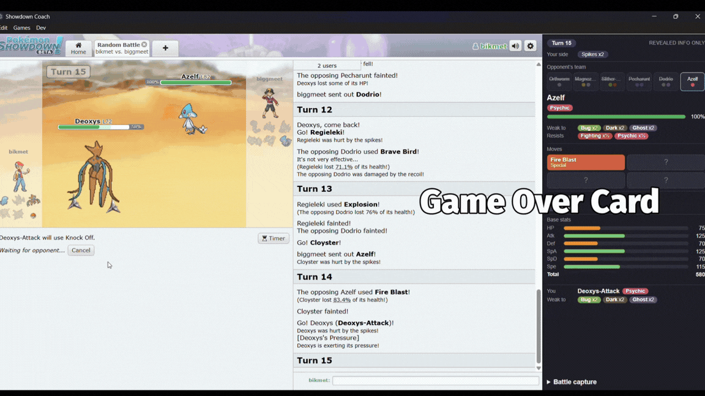
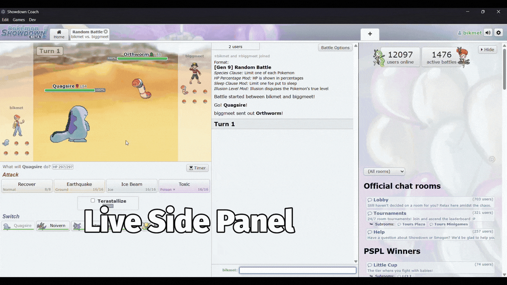
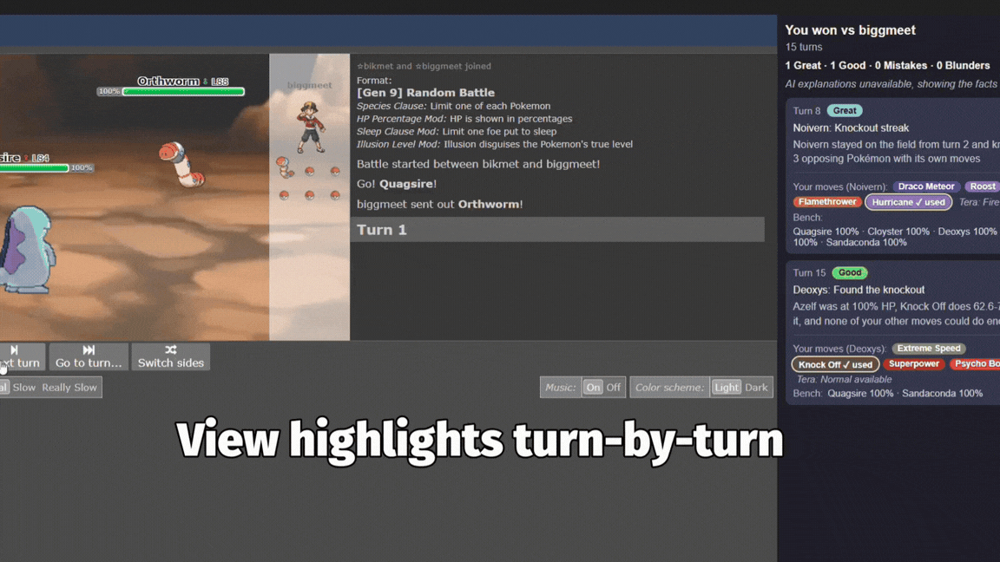

# Showdown Coach

A desktop app that wraps [Pokémon Showdown](https://play.pokemonshowdown.com) and adds a **chess.com-style post-game review**. When a battle ends, it picks out the key moments, labels each one **Great / Good / Mistake / Blunder**, and explains in plain English what happened and what you could have done instead. It's built for beginners.

Showdown Coach only flags what it's sure about. We tested letting an AI judge whole games and it invented mistakes. So in Showdown Coach, **the code judges and the AI explains.**


## Features

### Post-game review (the main feature)

- **Game Over card.** Pops up when the battle ends: the result, both players, the number of turns, a **"Team HP left, turn by turn"** graph (your team vs the opponent's), and how many Great / Good / Mistake / Blunder moments you had. The graph shows who had more HP left, not who played better. Opponent Pokémon you haven't seen yet count as full HP.

  

- **Review in the side panel.** Every key moment with its label and a plain-English explanation. Under each one, **"Your options this turn"** shows the moves you had, whether you could still Terastallize, and your bench, so you can see what you could have done instead. The review stays in the panel after you close the card.
- **Past games.** *Games → Past games…* opens the review of any battle you've played in the app, together with a replay of it (below).


### Live side panel

Toggle it with `Ctrl+Shift+K` (`Cmd+Shift+K` on macOS). During a battle it shows:

- the opponent's active Pokémon: types, Tera type, HP, what it's **weak to / resists / is immune to**, the moves it has revealed (hover for details), its possible abilities and base stats
- the opponent's team as far as you've seen it
- status, stat changes and other effects
- hazards, screens, weather and terrain
- a compact "You" block for your own active Pokémon

It shows only what's already been revealed in the battle, plus the type chart. That's the same information as Showdown's own tooltips, all in one place. **The side panel never gives advice during the battle.**



### Battle replay

When you open a past game, the battle replays where Showdown normally is, with the review still in the side panel next to it.

- **Click a moment in the review** (or Tab to it and press Enter) and the replay jumps to the **start of that turn**, the moment you made the choice the review is talking about.
- Play, pause and step through turns with the replay's own controls.
- **← Back to Showdown** (or *Games → Back to Showdown*) returns to Showdown. Showdown is only hidden while you watch, so you stay logged in. If a new battle starts while a replay is open, the app switches back to Showdown by itself.

The replay uses Showdown's own replay player, fed with the battle log the app saved, so it **needs an internet connection**. Offline, you get a short message instead, and the review still works.



## How it works

```
Showdown WebSocket ─► capture (Chrome debugger, read-only) ─► <room>.log

<room>.log ─► parser.js ─► state.js ─► review.js          (code: finds moments, assigns labels)
                         (per-turn battle)
review ─► Game Over card + side panel
       ─► ai.js ─► plain-English text, cached as <room>.review.json   (AI, optional)
```

1. **Capture.** The app watches the Showdown page's network traffic through Electron's debugger and writes every battle to a `.log` file. It never injects scripts into the page or changes it.
2. **Parse and track.** `parser.js` and `state.js` turn the log into a turn-by-turn picture of the battle: active Pokémon, HP, types (including Tera), moves used, and which moves you had available each turn.
3. **Judge (code).** `review.js` runs a set of rules and assigns every label. Each moment comes with the facts behind it.
4. **Explain (AI, optional).** `ai.js` makes one call per battle. The AI receives only the players, the result, and the flagged moments with their facts. It never sees the battle log and it can't add, remove or relabel moments. If anything goes wrong, you still get the review, just without the AI text.

All the work happens in Electron's main process. The pages (panel and card) only display what they're sent, and the API key never reaches them.

## Setup

You need [Node.js](https://nodejs.org) 20.12 or newer. We built and tested it on Windows 11.

```bash
npm install
npm start
```

The first `npm start` pauses for a minute with "Downloading Electron binary…". Electron downloads its program (100+ MB) on first run, not during `npm install`. That's normal.

Log in to Showdown inside the app with a username and password. The login is remembered between runs.

### Optional: AI explanations

Copy `.env.example` to `.env` and add a key. `.env` is git-ignored.

| Setting | Provider |
|---|---|
| `GEMINI_API_KEY` | Google Gemini (used first). Default models: `gemini-3.5-flash`, then `gemini-3.5-flash-lite` as a fallback. Change them with `GEMINI_MODELS`. |
| `AI_API_KEY` + `AI_ACCOUNT_ID` | Cloudflare Workers AI (used only when there's no Gemini key). Default model: `@cf/meta/llama-3.1-8b-instruct`. Change it with `AI_MODEL`. |

**No key, or no internet? The review still works.** You get every moment, label and fact, just without the AI's sentences (and without the replay, which also needs internet). `.env` is read each time it's needed, so you don't have to restart after editing it.

## Using it

1. Play a battle in the app (Gen 9 Random Battle is what we tested on).
2. When it ends, the Game Over card pops up. Close it to read the full review in the side panel.
3. To look at an older game: *Games → Past games…* Click a moment to jump the replay to that turn, then *← Back to Showdown* when you're done.

The **Dev** menu has:

- Toggle panel (`Ctrl/Cmd+Shift+K`)
- Reload Showdown (`Ctrl/Cmd+R`)
- Open review for a log file…
- Open DevTools for the Showdown view or for the panel view
- Print storage location
- Open battle-logs folder

## What the review checks

Every moment is judged **only with what you could see when you chose**, never with hindsight. Both players pick at the start of a turn, so something the opponent does during the turn (switching, Terastallizing) is never held against you.

| What happened | Label |
|---|---|
| Switched into a hit your Pokémon is immune to | Great |
| One Pokémon knocked out 3+ opponents in a row without leaving the field (2 if that ended the game) | Great |
| Terastallized into a type that resisted the hit | Good (Great if the old type was weak to it) |
| Knocked out the opponent with the only move that could | Good |
| Boosted Attack, Sp. Atk or Speed, then got 2+ knockouts with that Pokémon | Good |
| Used a move the target is immune to | Mistake |
| Used a move that could only fail (e.g. Stealth Rock when it's already up) | Mistake |
| Another move you had would surely have knocked it out | Mistake |
| Used a much weaker move than another option you had | Mistake / Blunder |
| Switched into a super-effective hit (25%+ of its HP lost; 50%+ or a knockout is a Blunder) | Mistake / Blunder |
| Switched into a super-effective move the opponent had already shown | Mistake |
| After a knockout, sent in a Pokémon weak to the obvious hit | Mistake / Blunder |
| Brought in a low-HP Pokémon that fainted before it could move, when a healthier one was available | Mistake |
| Terastallized into a type that was weak to the hit | Mistake / Blunder |

The move-choice rules use damage estimates from [`@smogon/calc`](https://github.com/smogon/damage-calc) (the engine behind Showdown's damage calculator), with Random Battle stat spreads plus the stat boosts, weather, terrain, screens, items and abilities revealed so far. The opponent's unknown ability is treated as the worst case, and there's a safety margin for its unknown item. A move under 90% accuracy is never suggested as the better choice. If an estimate isn't possible, the rule says nothing.

All thresholds live in one `CONFIG` object at the top of `src/core/review.js`.

### Limitations

- It only flags moments that match one of its rules, and the AI only explains those, so many turns get no comment. That's on purpose, as a wrong "Mistake" flag does more harm than saying nothing.
- It can't tell a deliberate sacrifice from a mistake, or a bold prediction from a risky switch.
- It may flag a weaker move you chose for its side effect (Knock Off, Rapid Spin…).
- It doesn't judge stay-or-switch decisions, hazards, speed, status moves, predictions or accuracy risk.
- Singles only. Built and tested on Gen 9 Random Battle. The damage numbers assume Random Battle sets, so they can be far off in formats with real teams.

## Fair play

- The app never modifies or scripts the Showdown page. It only watches network traffic.
- The live panel never recommends moves, predicts the opponent, or reveals hidden information.
- We tested only against our own second accounts and friends.
- Outside help during tournament games ("ghosting") is against Smogon's tournament rules.

## Developer notes

```bash
npm test                                            # Node's built-in test runner on test/*.test.js
npm run summarize -- test-data/<file>.log           # turn-by-turn summary of a saved log
npm run show-review -- test-data/<file>.log         # the review of a saved log
npm run show-review -- test-data/<file>.log --options   # ...plus the damage estimate for every move you had
npm run check-damage                                # how close damage estimates are to real hits in test-data/
node scripts/try-ai.js test-data/<file>.log         # run a review through the real AI (reads .env)
```

Tests use real battle logs from our own accounts in `test-data/`. Opponent names are anonymised.

### Project layout

```
src/
  main/                    Electron main process: does all the work
    main.js                window, the views (Showdown, panel, replay), menu
    replay-watch.js        retries the replay once if it doesn't start
    capture.js             reads Showdown's WebSocket frames through the debugger
    logs.js                writes <room>.log and <room>.review.json
    live-info.js           feeds the live panel
    review-overlay.js      the Game Over card's view
    ai.js, ai-config.js    AI explanations and the .env settings
  core/                    pure JavaScript: no Electron, files, network or timers
    parser.js              one protocol line -> data
    state.js               a whole log -> per-turn battle
    data.js                generation-aware types, matchups, moves (via @pkmn/data)
    damage.js              damage estimates (via @smogon/calc)
    review.js              the rules: moments + labels
    card-extras.js         the HP graph data for the Game Over card
    live-info.js           what the live panel shows
    requests.js            restores your move lists after a page reload
    review-cache.js        decides when a saved AI review can be reused
  renderer/                pages: they only display what main sends them
    panel.html, panel*.js, panel*.css    side panel (Live, Review, Debug)
    overlay/               the Game Over card
    replay.html, replay-*.js   the replay page (Showdown's replay player + our Back button)
    *-preload.js           small contextBridge APIs, one per page
    fonts/                 Fira Sans + its licence
scripts/                   command-line helpers (above)
test/                      *.test.js and fixtures
test-data/                 real battle logs (opponents anonymised)
```

### Good to know

- **Battle logs** go to `<userData>/battle-logs/<room>.log`. On Windows: `C:\Users\<you>\AppData\Roaming\pokemon-helper-electron-spike\battle-logs`. The folder name comes from the `name` in `package.json`. We kept the old name because changing it would log you out and leave old logs behind.
- **Opening DevTools on the Showdown view stops capture** until you restart the app.
- **Reloading Showdown replays the room's history.** The log file is started fresh at that point (no duplicate lines), and the move lists captured before the reload are put back.
- Every page runs with `contextIsolation`, `sandbox` and no Node integration. Server text is shown with `textContent`, never `innerHTML`.
- The replay page loads Showdown's player from `play.pokemonshowdown.com` only (enforced by its Content Security Policy), in its own in-memory session, so it never sees your Showdown login.
- Showdown popups and external links open in your normal browser.

## Built with

- [Electron](https://www.electronjs.org) 45
- [`@pkmn/dex`](https://github.com/pkmn/ps) and [`@pkmn/data`](https://github.com/pkmn/ps): Pokémon data
- [`@smogon/calc`](https://github.com/smogon/damage-calc) 0.12: damage estimates
- [Pokémon Showdown](https://pokemonshowdown.com)
- [Google Gemini](https://ai.google.dev) / [Cloudflare Workers AI](https://developers.cloudflare.com/workers-ai/) for the explanations
- [Fira Sans](https://fonts.google.com/specimen/Fira+Sans) (SIL Open Font License, see `src/renderer/fonts/`)

Pokémon is © Nintendo / Game Freak / The Pokémon Company. This is an unofficial fan project, not affiliated with them or with Pokémon Showdown.

## Team

- [@Kwokym111](https://github.com/Kwokym111)
- [@bikmet](https://github.com/bikmet)

## License

MIT. See [LICENSE](LICENSE).
